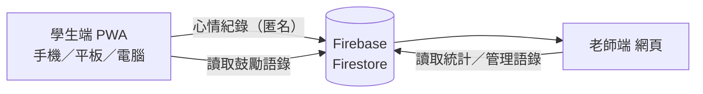

# ⚡ 考前充電站
### 國小 4–6 年級測驗焦慮情緒調節工具

> 考試前心跳好快？寫作業卡住想發脾氣？
> 「考前充電站」陪孩子認識自己的情緒，用簡單的方法幫心情充飽電。

| 項目 | 內容 |
|---|---|
| 課程名稱 | （請填寫課程名稱） |
| 組別 | 第 ＿ 組 |
| 小組成員 | ○○○（學號）、○○○（學號）、○○○（學號）、○○○（學號） |
| Repo 網址 | https://github.com/tuts00268-maker/EXIT-06 |
| 線上展示 | （部署後填寫，例如 GitHub Pages 網址） |

---

## 📌 專題緣起

本組第一次作業「心事悄悄話」問卷調查了 51 位國小學童，發現：

- **41.2%** 的孩子面對隨堂測驗會「有點緊張、怕考不好」或「心跳好快」
- **54.9%** 的孩子期待看到老師鼓勵的評語
- **35.3%** 的孩子遇到不會寫的題目時，身邊沒有人可以問

孩子們的情緒是真實存在的，但多數時候沒有工具可以即時處理。因此我們設計「考前充電站」，讓孩子在**考試前、寫作業卡關時**，能夠覺察情緒並學會自我調節。

## 🎯 目標使用者

- **學生**（國小 4–6 年級）：自評心情、使用情緒調節小工具
- **老師**：查看匿名的全班心情趨勢、管理鼓勵語錄

## ✨ 核心功能

1. **心情打卡**：用表情圖示選擇現在的心情（開心／還好／緊張／生氣／難過），並用 1–5 顆電池表示強度
2. **情緒調節工具箱**：依心情自動推薦
   - 🫧 **呼吸泡泡**：跟著動畫做 4-7-8 呼吸練習
   - 💬 **打氣小語**：隨機顯示老師寫給大家的鼓勵話語
   - 🧭 **卡關策略卡**：「先跳過這題」、「把題目再讀一次」等解題小撇步
3. **充電前後對照**：使用工具後再打卡一次，看見自己心情的變化
4. **老師端心情溫度計**：以匿名方式呈現全班心情分布，作為調整教學節奏的參考

## 🏗️ 系統架構



| 層級 | 技術 |
|---|---|
| 前端 | HTML／CSS／JavaScript（Tailwind CSS）、PWA 可安裝於手機主畫面 |
| 圖表 | Chart.js |
| 後端／資料庫 | Firebase Authentication、Cloud Firestore |
| 部署 | GitHub Pages 或 Firebase Hosting |
| APP 封裝（選用） | Capacitor 打包為 Android APP |

## 🔒 隱私與安全設計

- **不收集臉部影像或錄音**，只記錄孩子主動選擇的心情圖示
- 學生以**代號**登入，老師端只看得到**匿名統計**，看不到個人紀錄
- 使用前需取得**家長同意**
- 定位為「情緒覺察與調節」的學習工具，**不做任何心理診斷**
- 若孩子連續多天回報負面情緒，系統會提醒老師主動關心，並轉介輔導室

## 🖼️ 畫面截圖

| 首頁／心情打卡 | 呼吸泡泡 | 老師端心情溫度計 |
|:---:|:---:|:---:|
|  |  |  |

> 前期調查成果：[第一次作業「心事悄悄話」儀表板](docs/survey-dashboard.html)

## 🚀 如何執行

```bash
git clone https://github.com/tuts00268-maker/EXIT-06.git
cd EXIT-06
# 直接用瀏覽器開啟 index.html，或啟動本機伺服器：
npx serve .
```
